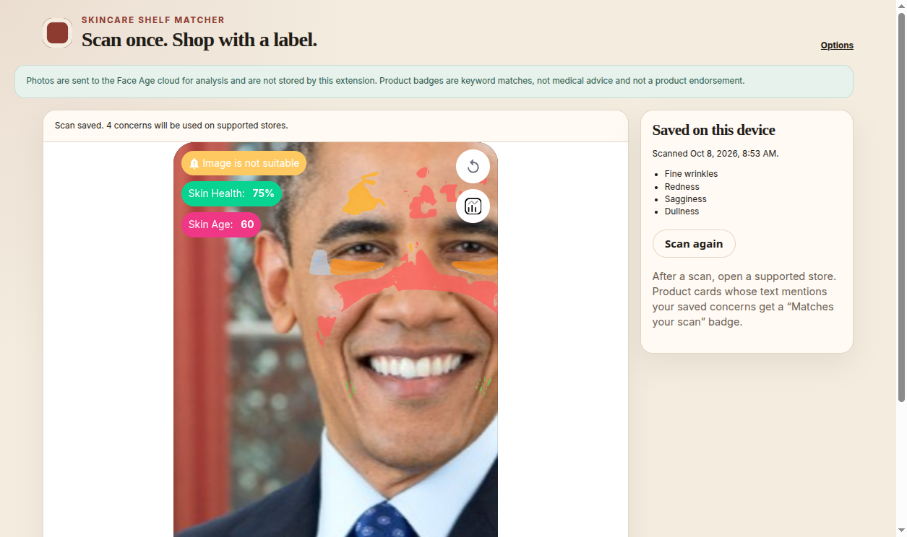
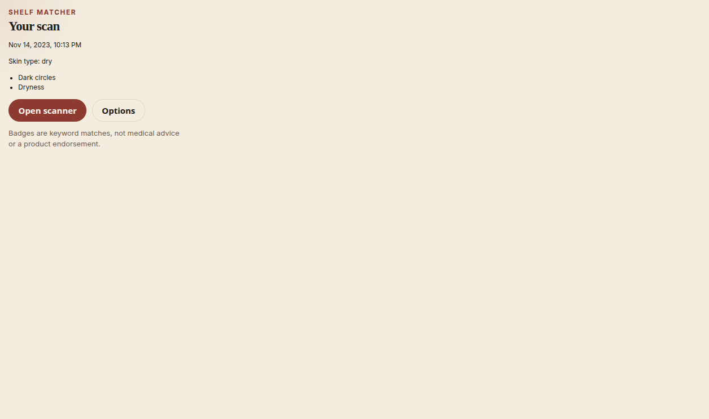
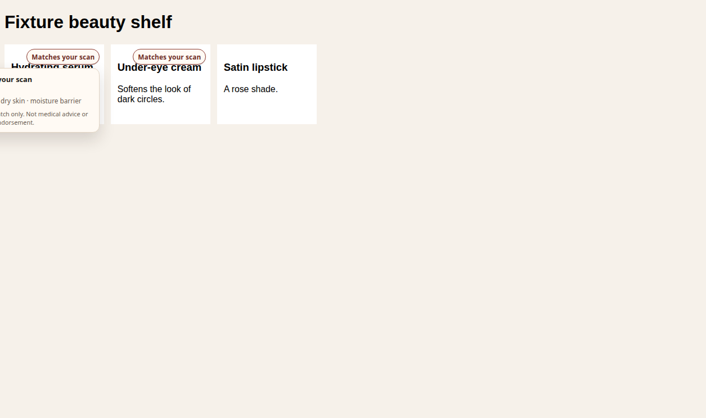

# Skincare Shelf Matcher: a skincare browser extension for skin analysis and product matching

Skincare Shelf Matcher is an open-source skincare browser extension and product matcher for Chrome and Firefox. You run one facial skin analysis with the [face-age SDK](https://www.npmjs.com/package/face-age) from [Face Age](https://getfaceage.com). The Chrome extension then badges product cards on beauty stores when the title or description mentions the concerns from that scan, such as acne, wrinkles, or dark spots.

Matching is a keyword check. It is not a diagnosis, and a badge is not a recommendation to buy the product.







The store image is a desktop capture of [The Ordinary’s Signs of Congestion page](https://theordinary.com/en-us/category/skincare/shop-by-concern/signs-of-congestion). The sample profile contains acne, fine wrinkles, deep wrinkles, and pigment. Badges appear on products whose titles mention acne or salicylic acid.

## Features

- One facial skin analysis in a full browser tab, using the camera or a photo upload.
- A saved profile of concern keys, optional skin type, and the scan time. The photo is not stored.
- **Matches your scan** badges on allowlisted beauty retailers, with the matched concern and keyword on click.
- A Client ID that stays in this browser. The popup and the scan page explain how to add one before the scanner starts.
- Chrome and Firefox builds from the same Manifest V3 package.

## How it works

1. Add a Face Age Client ID on the options page. It is stored in `chrome.storage.local` on this browser. On a fresh install with no ID saved, the options page opens by itself. Until an ID is saved, the popup and the scan page show a short setup message with an **Open settings** button and a link to [panel.getfaceage.com](https://panel.getfaceage.com/). The scanner does not start in that state.
2. Open the scanner in a full tab so the camera permission prompt can appear. Take a photo or upload one.
3. The extension keeps concern keys that scored above a threshold, skin type when the scan includes one, and the time of the scan.
4. Browse an allowlisted store. Matching product cards show a badge. Select it to see which concerns and words matched.

The toolbar popup shows the saved profile and links to the scanner and options.

Concerns are kept when the score is at least 30 out of 100. Acne is kept when the count is at least 1. Both cutoffs live in `src/lib/profile.ts`.

## Supported stores

The extension ships with an allowlist of beauty retailers:

- Sephora
- Ulta
- Dermstore
- Paula’s Choice
- [The Ordinary](https://theordinary.com/en-us/category/skincare/shop-by-concern/signs-of-congestion)
- Cult Beauty
- Lookfantastic
- Space NK
- Glossier
- Beauty Bay
- YesStyle
- iHerb
- The Inkey List

Edit the list in options. A site that is not in the default set needs an extra permission prompt.

Removing a default site stops badging there. Chrome still lists that site under the extension’s required access, because required host permissions cannot be revoked from the options page. The content script checks the saved list and does nothing when the site is not on it.

Product cards are found with heuristics (`product-card`, `product-tile`, schema.org Product, and similar). A custom storefront can be missed. The dictionary is specific, so a word like “glowing” does not match “glow”.

## Installation

```bash
npm install
npm run build
```

`dist/` is an unpacked extension.

### Chrome

1. Open `chrome://extensions`.
2. Turn on **Developer mode**.
3. Choose **Load unpacked** and select the `dist` folder.
4. Open the extension’s options, paste your Client ID, and save.
5. Open the scanner from the popup or the options page.

### Firefox

Firefox 128 or newer:

1. Open `about:debugging#/runtime/this-firefox`.
2. Choose **Load Temporary Add-on** and select `dist/manifest.json`.
3. Use the options page the same way as in Chrome.

The extension id in Firefox is `skincare-shelf-matcher@getfaceage.com`. Temporary add-ons are removed when Firefox exits. Firefox is the same package and is less heavily exercised than Chrome.

## Configuration

### Getting a Client ID

Create a free Face Age Client ID at [panel.getfaceage.com](https://panel.getfaceage.com/). Paste it into the options page. The same panel link sits next to the Client ID field, and the popup and scan page link there when no ID is saved.

The ID stays in extension storage on this browser. Clear the field and save if you want to remove it. **Delete my data** removes the saved scan and leaves the Client ID and store list in place.

If a Client ID is limited to particular sites, add `http://localhost` on the Face Age panel. The scan page explains why under Development.

## Privacy

- The photo is uploaded to the Face Age cloud (`core.getfaceage.com`) for analysis. The scan page says this before you start.
- This extension writes only the profile described above. `history` is off in the widget, so the SDK is not asked to keep scan photos in `localStorage`.
- The quiz inside the widget is off, so the extension does not run Face Age’s extra questions (allergy, routine length, and so on). Skin type is stored only when a result payload already includes it.
- Google Analytics and Facebook Pixel are not given ids, script insertion is turned off, and those hosts are not requested by the scanner.
- **Delete my data** on the options page removes the saved profile.
- Badges are keyword matches. They are not medical advice and they are not a product endorsement.

## Development

```bash
npm install
npm test
npm run lint
npm run build
```

`npm test` runs Vitest on profile building, keyword matching, domain parsing, product-card badging, the Client ID setup rules, and the SDK patch.

`npm run check:widget` loads `dist/` in Chrome for Testing, saves a Client ID from `FACEAGE_CLIENT_ID` or `.env.local`, and drives the scan page through a sample photo. The check uses software WebGL. MediaPipe waits on a GL sync, and a Chrome launch with the GPU disabled never finishes that wait. Copy `.env.example` to `.env.local`. Do not commit a Client ID. The local fixture capture used by that check is written outside this repository so it does not replace `docs/screenshots/store.png`.

English terms are the main dictionary. Persian (`fa`) terms are included so another language is a data change. Add a language by putting a string array on `terms` in `src/lib/dictionary.ts`.

### Running the face-age SDK on an extension page

[`face-age`](https://www.npmjs.com/package/face-age) 2.4.11 is a browser widget. `new FaceAge(options).render()` needs a DOM, a camera or an upload, a network connection, and a Client ID. MediaPipe Face Mesh runs in the page for face and pose checks, then the photo is uploaded to the Face Age API. The published package is minified. `package.json` points `types` at `dist/FaceAge.d.ts`, but that file is not in the tarball, so this repo has a small hand-written declaration in `src/types/face-age.d.ts`.

The scanner is the extension page `src/scan/scan.html`. `#FaceAge-module` is in that markup, and the SDK renders into it there.

The published build does not fit a normal extension page as shipped. `script-src` is `'self'` plus `'wasm-unsafe-eval'` (MediaPipe compiles WebAssembly). Remote scripts, inline scripts, and `eval` are not allowed. `scripts/patch-faceage.mjs` changes the bundle so it stays inside that policy:

- Chart.js, Swiper, and MediaPipe Face Mesh (`@mediapipe/face_mesh` 0.3.1620248508) are copied into the extension. The SDK loads them from `/vendor/` instead of a CDN. The MediaPipe script tag no longer sets `crossorigin="anonymous"`, which extension files cannot satisfy.
- The radar chart and Swiper carousels were inline scripts inside the widget frame. The patch calls `Chart` and `Swiper` on that frame’s window instead.
- Webpack’s `new Function("return this")` fallback, and MediaPipe’s embind `new Function` helper, are replaced with ordinary functions.
- Webpack chunk loading only treated `http(s)` URLs as a script base. The patch also accepts `chrome-extension:` so the chunks packaged next to `faceage.js` load.
- The widget still creates its own iframe, `#FaceAge-module-iframe`, with no `src`. The document is `about:blank`, and the SDK writes the scanner into it. It is not a remote page, a blob URL, or `srcdoc`, so the extension policy does not need a `frame-src` change. `#FaceAge-module` on the scan page is only the host. The extension does not add a second sandbox frame. Parent CSS does not apply inside the frame, so the scan page copies the `#faceAge-module-body` rule into the frame document.

Stylesheets are not scripts. Face Age CSS still comes from `static.getfaceage.com`, and the UI fonts still come from Google Fonts. Swiper’s CSS is packaged.

The scan page’s origin is `chrome-extension://…`. The Face Age API rejects that origin and a `null` origin (`It is not possible to access`). It does accept `http://localhost`. A declarativeNetRequest rule rewrites the `Origin` header to `http://localhost` only for `https://core.getfaceage.com/*`. The photo is still uploaded to Face Age.

Grant camera access when the browser asks. If the camera cannot start, upload a photo instead. Both controls are enabled. A completed scan needs a working Client ID and a photo the Face Age service accepts.

Some decorative SVGs referenced by the published Face Age stylesheet are missing from the CDN (`/v2.2/images/...` returns 404). The scanner still runs.

### Contributing

Issues and pull requests are welcome. Keep code, comments, docs, and commit messages in English.

- Matching behavior belongs in `src/lib` with a unit test.
- New store defaults go in `DEFAULT_ALLOWLIST` in `src/lib/domains.ts`.
- New dictionary languages are extra keys on `terms`. They are included automatically.
- Do not store images, raw analysis payloads, or analytics ids.

## FAQ

### What is Skincare Shelf Matcher?

A browser extension that runs one Face Age skin analysis and then highlights skincare products whose text mentions the saved concerns.

### Where do I get a Face Age Client ID?

Create one at [panel.getfaceage.com](https://panel.getfaceage.com/) and paste it into the extension options. The scanner stays off until that ID is saved.

### Does the extension keep my photo?

The photo is sent to Face Age for analysis and is not written to extension storage. The saved record is the concern list, skin type when the result includes one, and the scan time.

### Is a match badge medical advice or a product endorsement?

No. A badge means the product title or description contains a keyword for a saved concern.

### Which browsers can install it?

Chrome, with **Load unpacked**, and Firefox 128 or newer, with **Load Temporary Add-on**. The project is a Manifest V3 extension.

## License

[MIT](LICENSE).

Third-party pieces used at runtime:

| Piece                                                                      | Version        | License    | How it is loaded                        |
| -------------------------------------------------------------------------- | -------------- | ---------- | --------------------------------------- |
| [face-age](https://www.npmjs.com/package/face-age)                         | 2.4.11         | MIT        | Packaged from npm, with the patch above |
| [chart.js](https://www.npmjs.com/package/chart.js)                         | 4.4.6          | MIT        | Packaged                                |
| [swiper](https://www.npmjs.com/package/swiper)                             | 11.2.10        | MIT        | Packaged                                |
| [@mediapipe/face_mesh](https://www.npmjs.com/package/@mediapipe/face_mesh) | 0.3.1620248508 | Apache-2.0 | Packaged                                |
